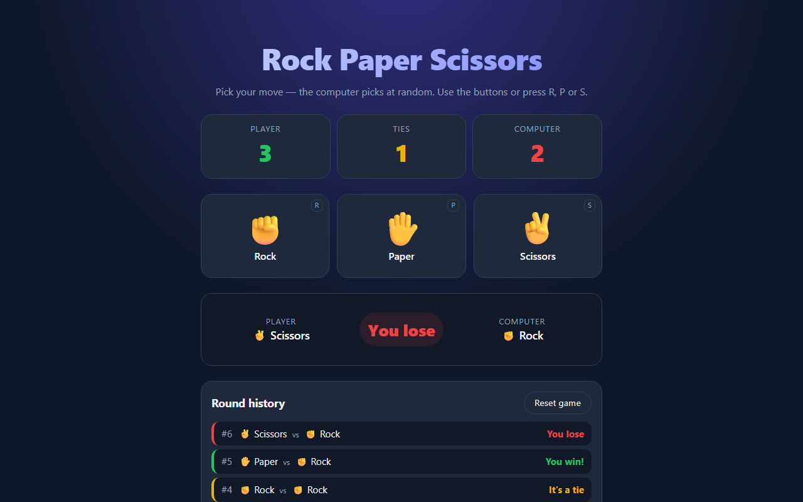

# Rock Paper Scissors

[](https://codelady-ship.github.io/rock-paper-scissors/)

> AZ: Kompüterə qarşı "Daş-Kağız-Qayçı" oyunu — xal tablosu, raund tarixçəsi və sıfırlama düyməsi ilə.

A browser game of Rock Paper Scissors against the computer, built with plain HTML, CSS and JavaScript.



## Features

- Play with the buttons or the keyboard (**R**, **P**, **S**).
- Score board for player wins, computer wins and ties, colour-coded (green = you, red = computer, yellow = ties).
- Round history with the last 10 rounds.
- **Reset game** button.
- Score and history are kept in `localStorage`, so a reload does not lose your game.
- Responsive layout from 390 px phones to 1920 px screens, with no horizontal scroll.
- SEO basics: description, canonical URL, Open Graph/Twitter tags, favicon, `robots.txt`, `sitemap.xml`.

## Tech stack

HTML5 · CSS3 (custom properties, grid, `clamp()`, media queries) · vanilla JavaScript (ES6+) · `localStorage`

## Run locally

```bash
git clone https://github.com/codelady-ship/rock-paper-scissors.git
cd rock-paper-scissors
npx serve .        # or just open index.html in a browser
```

## Deployment

GitHub Pages serves the root of the `main` branch at <https://codelady-ship.github.io/rock-paper-scissors/>.
The old address `/RockPaperScissors.html` redirects to the new one.

## What I learned

- Replacing a long `switch` with a small lookup table (`BEATS`) makes the win logic shorter and easier to read.
- Fixed widths (`width: 35rem`, `min-width: 160px`) break phones; `grid`, `clamp()` and fluid units fix it.
- CSS fails silently: `margin: 30px,0` is invalid and was simply ignored by the browser.
- Keeping all game data in one `state` object makes reset, history and saving to `localStorage` simple.
- Renaming the entry page to `index.html` gives the project a clean URL, and a small redirect page keeps old links working.
